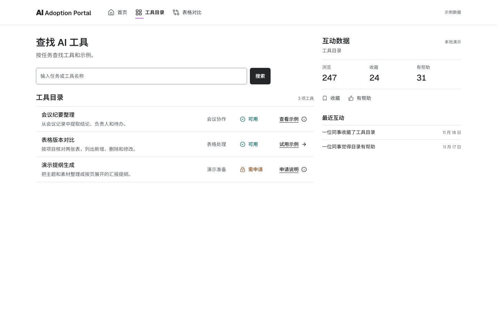

# AI Adoption Portal 视觉规范

这套规范供设计师和前端工程师共同维护员工 Portal。员工可以在首页阅读同事的实践案例，在目录里查找 AI 工具，也可以进入「表格版本对比」查看两份表格的差异。当前版本为 **v2.5**。

## 从哪里开始

| 你想做什么 | 打开 |
| --- | --- |
| 开发新页面或核对设计稿 | [DESIGN.md](./DESIGN.md) 包含颜色变量、字号与行高、组件状态、栅格断点和 CSS 示例。文件开头的 `review` 区分已确认的规则与待验证的建议。 |
| 看组件如何配合使用 | [Portal 视觉规范](./Portal视觉规范.html) 可以查看色板、图标和组件，切换栅格宽度，也可以复制或下载规范原文。 |
| 走一遍员工的使用流程 | [产品样张](./产品样张.html) 可以切换页面、搜索工具、查看示例和比较表格。页面中的互动数据为本地演示数据。 |

在 GitHub 上可以直接阅读规范和查看截图。要操作两个 HTML 页面，在仓库首页选择 **Code → Download ZIP**，解压后用浏览器打开对应文件即可。预览支持离线使用，无需安装依赖或启动服务。

## Portal 的视觉约定

| 元素 | 用法 |
| --- | --- |
| 颜色 | 墨色 `#242628` 用于主按钮、当前导航文字和列表链接。图片中取样的亮紫 `#BF63F3` 只出现在当前导航下方的 24 × 2 px 短线和键盘焦点环。 |
| 字体与图标 | 西文和数字使用 Geist Sans。简体中文建议搭配 Noto Sans SC，系统后备为苹方和微软雅黑。导航和工具行使用 Lucide 线性图标。 |
| 搜索与列表 | 搜索框左侧直接输入文字，右侧是墨色「搜索」按钮，输入后出现文字「清除」。工具逐行排列在单层白底上，以细线分隔，行尾操作常显下划线。 |
| 响应式布局 | 宽屏上，顶栏与正文共用对齐线。1440 px 视口左右各留 104 px，主栏与互动栏按 2∶1 分配，两栏间距 24 px。小于 776 px 时，互动数据移到主内容下方。 |

[查看手机目录](./工具目录-手机.png) · [查看键盘焦点、悬停与收藏状态](./组件状态实测.png) · [查看首页征文与互动栏](./征文与互动.png)

## 维护与发布

修改视觉规则时，先更新 [DESIGN.md](./DESIGN.md)，再用产品样张验证受影响的状态。可视化规范内嵌了 Markdown 和产品样张的副本，发布新版本时要同步这两份内容，并更新受影响的截图，让读者下载到的规范与看到的界面一致。

上传到 GitHub 时保留本目录内的文件名和相对位置。将本目录的内容放在仓库根目录，GitHub 就会把这份 README 展示为仓库首页。

早期字体和栅格方案收录在随附的[视觉研究附录](./Portal视觉参考.html)。规范末尾引用的「实验版设计记录」保存在团队原工作区，单独发布本目录时该条历史链接仅供团队内部追溯。
